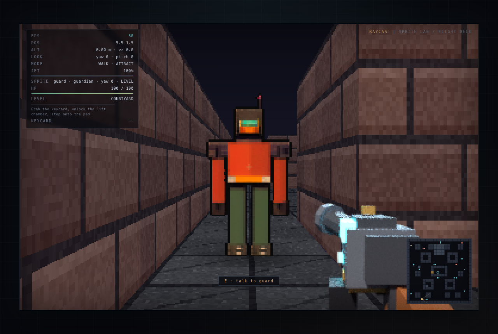

# Raycast — Vertical 2.5D Sprite Lab

A from-scratch software raycaster in TypeScript with true vertical movement and a
reproducible pipeline for multi-angle character sprites, based on
[the project spec](docs/spec/AI-Sprites-In-Raycasting-Games.pdf).

**Live demo:** https://raycast-rosy.vercel.app

> **Status:** combat, interaction, doors, and transitions are live, M8 polish has landed
> procedural audio plus a pause/settings menu (mouse sensitivity, FOV, mute), and M9 adds
> a first-person viewmodel with attack animation. The guardian is the only shipped
> chassis, so every actor renders through its six-state atlas
> (idle/walk/attack/hurt/death/talk).



*A guardian at close range, with the plasma projector viewmodel in the lower-right. The
same courtyard from jetpack altitude, where wall tops and the full actor set are visible,
is in [docs/screenshots/courtyard.png](docs/screenshots/courtyard.png).*

The engine renders a 384×240 framebuffer to Canvas 2D: DDA grid traversal, textured
walls, floors and per-cell tops, a true rotational pitch camera, per-pixel depth, and
jetpack flight up to 18 m. Walls are solid 1.4-unit blocks you can land on; map digits
build walkable 0.2/0.4 stairs and a 0.6 crate. The guardian Blender chassis is rendered
from 16 yaw angles × 4 pitch angles × 19 poses (1,216 frames across idle, walk, attack,
hurt, death, and talk), stylized to 96×96 pixel art by SD1.5 + depth ControlNet
(deterministic palette stylizer as fallback), and packed into one atlas. Height and pitch
drive frame selection, including a dedicated near-overhead row with a compensating
billboard scale, so actors keep a stable apparent size from the floor to the ceiling. A
Blender-rendered first-person viewmodel (both gauntlets plus a plasma projector) animates
through idle, wind-up, strike, and recovery, and bob follows the walk cycle.

**Status:** playable build with two levels, combat with hurt/death states, NPC dialogue,
doors, keycard/medkit/fuel pickups, level transitions, synthesized audio, and a
pause/settings menu. Verification runs a 97-scenario deterministic matrix (625 checks),
a 40-check happy-path browser run, and a 42-check paused-state gallery capturing every
body state. The M6 AI stylization infrastructure (Blender depth/normal controls, ComfyUI
img2img + ControlNet, silhouette/palette verification, MCP studio server) remains the
asset path. See the [roadmap](docs/ROADMAP.md), [pipeline](docs/PIPELINE.md), and
[progress log](docs/PROGRESS.md).

## Quick start

Requirements: Node.js 20+ (tested on 24). Blender is only needed to regenerate sprites.

```bash
npm install
npm run dev        # http://localhost:5173
npm test           # unit tests
npm run typecheck
npm run build      # static build in dist/
npm run playtest   # headless Chrome: input, physics, atlas, viewmodel, screenshot checks
npm run playtest:matrix  # 97 deterministic state/interaction/combat/level scenarios
npm run playtest:states  # paused-state gallery: 42 checks, 21 captures
```

## Controls

| Input | Action |
| --- | --- |
| Click canvas | Lock pointer / enter the demo |
| Mouse | Look (yaw + pitch) |
| `W A S D` | Move |
| `Shift` | Sprint |
| `Space` | Ignite/hold jetpack (ground jump or sustained lift) |
| `F` / left click | Strike (45 damage, 2.3 m cone, 0.45 s cooldown) |
| `E` | Interact: talk, open doors, collect pickups |
| `F2` | Toggle freefly debug mode (`Space` up, `Ctrl`/`C` down) |
| `M` / `Tab` | Toggle minimap |
| `F3` | Toggle detailed HUD |
| `R` | Respawn |
| `Esc` | Release pointer and pause (opens settings) |

The pause panel adjusts mouse sensitivity, field of view, and audio mute; settings
persist locally. Audio is synthesized with WebAudio and starts on the first click.
Append `?screenshot` to the URL to hide the overlays for automated captures.

## Asset pipeline

The full pipeline regenerates every visual asset:

```bash
npm run assets            # textures → Blender renders → palette stylize → atlas

# AI style pass (ComfyUI running locally with a checkpoint + depth ControlNet):
npm run assets:comfy -- guardian --checkpoint sd15.safetensors \
  --controlnet control_v11f1p_sd15_depth.pth --style "SNES RPG, muted palette"
npm run assets:comfy -- guardian --palette   # deterministic fallback, no server
npm run assets:verify                        # silhouette IoU + palette drift report
```

Individual stages, ComfyUI setup, frame naming, and atlas schema are documented in
[docs/PIPELINE.md](docs/PIPELINE.md). Raw Blender renders, control passes, and intermediate
stylized frames are reproducible and gitignored; the packed atlas is committed.

| Command | Output |
| --- | --- |
| `npm run assets:textures` | `public/assets/textures/{brick,panel,floor}.png` |
| `npm run assets:blender` | 1,216 raw + 2,432 control PNGs in `assets-src/characters/<id>/` |
| `npm run assets:stylize` | 96×96 palette frames per character |
| `npm run assets:comfy` | 96×96 AI frames (or `--fallback`/`--palette`) |
| `npm run assets:verify` | `artifacts/style-report.json` (gitignored) |
| `npm run assets:atlas` | `atlas.png` (1536×7296) + `atlas.json` |
| `npm run mcp:studio` | stdio MCP tools for atlas generation/repair |

The character commands default to guardian; pass a name only if another chassis has raw
renders and a stylized frame set.

## Repository map

```
src/engine/      DDA, world/collision, renderer, atlas loader, input, audio, math
src/content/      courtyard + reactor level definitions, actors, props
src/game.ts       player physics, jetpack, camera, animation, minimap, HUD
src/main.ts       asset boot, render loop, pointer lock, debug API
tools/assets/     deterministic wall/floor texture generator
tools/blender/    headless turntable + viewmodel: raw, depth, and normal passes
tools/stylize/    palette stylizer, shared downsample, ComfyUI CLI wrapper
tools/comfy/      API-format workflow + placeholder validation + HTTP client
tools/verify/     silhouette IoU and palette-drift metrics/report
tools/atlas/      atlas packer + manifest generator
tools/mcp/        stdio MCP server for atlas generation and single-view repair
tools/playtest/   CDP harness: happy-path run, state matrix, paused-state gallery
.qoder/agents/    playtester subagent definition
tests/            Vitest coverage for DDA, math, world, atlas, settings, Comfy workflow, style metrics
docs/             spec, roadmap, progress, architecture, pipeline, handoff, ADRs
```

## Documentation

- [Roadmap](docs/ROADMAP.md) — milestones, checkboxes, acceptance criteria
- [Progress](docs/PROGRESS.md) — current status, verification evidence, session log
- [Architecture](docs/ARCHITECTURE.md) — rendering math and module map
- [Pipeline](docs/PIPELINE.md) — asset generation and atlas schema
- [Playtest matrix](docs/PLAYTEST-MATRIX.md) — scenario catalog, determinism, audit
- [Handoff](docs/HANDOFF.md) — commands, debug API, invariants, next steps
- [Decisions](docs/DECISIONS.md) — architecture decision records
- [Original spec](docs/spec/AI-Sprites-In-Raycasting-Games.pdf)

## License

No license has been chosen yet. Treat the repository as all-rights-reserved until one
is added.
