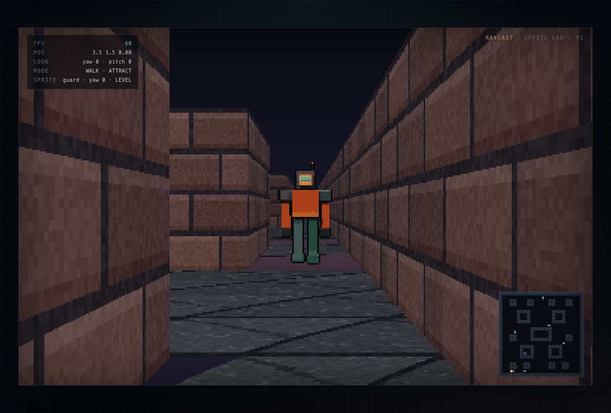

# Raycast — Vertical 2.5D Sprite Lab

A from-scratch software raycaster in TypeScript with true vertical movement and a
reproducible pipeline for multi-angle character sprites, based on
[the project spec](docs/spec/AI-Sprites-In-Raycasting-Games.pdf).



The engine renders a 384×240 framebuffer to Canvas 2D: DDA grid traversal, textured
walls and floors, per-pixel depth, Y-shear pitch, jump/gravity/fly, and 8-direction
sprites that switch between low/level/high pitch views. The sample guard is a Blender
proxy rendered from 8 yaw angles × 3 pitch angles × 6 animation poses (144 frames),
stylized to 96×96 pixel art and packed into one atlas.

**Status:** playable M4 build. Core renderer, vertical movement, directional sprites,
and the full Blender → stylizer → atlas pipeline work end-to-end. Variable-height
sectors and the AI stylization stage are the next milestones — see the
[roadmap](docs/ROADMAP.md) and [progress log](docs/PROGRESS.md).

## Quick start

Requirements: Node.js 20+ (tested on 24). Blender is only needed to regenerate sprites.

```bash
npm install
npm run dev        # http://localhost:5173
npm test           # 21 unit tests
npm run typecheck
npm run build      # static build in dist/
```

## Controls

| Input | Action |
| --- | --- |
| Click canvas | Lock pointer / enter the demo |
| Mouse | Look (yaw + pitch) |
| `W A S D` | Move |
| `Shift` | Sprint |
| `Space` | Jump |
| `F2` | Toggle fly mode (`Space` up, `Ctrl`/`C` down) |
| `M` / `Tab` | Toggle minimap |
| `F3` | Toggle detailed HUD |
| `R` | Respawn |
| `Esc` | Release pointer |

Append `?screenshot` to the URL to hide the intro overlay for automated captures.

## Asset pipeline

The full pipeline regenerates every visual asset:

```bash
npm run assets            # textures → Blender renders → stylize → atlas
```

Individual stages, requirements, frame naming, and atlas schema are documented in
[docs/PIPELINE.md](docs/PIPELINE.md). Raw Blender renders and intermediate stylized
frames are reproducible and gitignored; the packed atlas is committed.

| Command | Output |
| --- | --- |
| `npm run assets:textures` | `public/assets/textures/{brick,panel,floor}.png` |
| `npm run assets:blender` | 144 RGBA renders in `assets-src/character/raw/` |
| `npm run assets:stylize` | 96×96 pixel-art frames in `public/assets/sprites/character/frames/` |
| `npm run assets:atlas` | `atlas.png` (768×1728) + `atlas.json` |

## Repository map

```
src/engine/      DDA, world/collision, renderer, atlas loader, input, math
src/content/      demo map + actor placements
src/game.ts       player physics, camera, animation, minimap, HUD
src/main.ts       asset boot, render loop, pointer lock, debug API
tools/assets/     deterministic wall/floor texture generator
tools/blender/    headless turntable renderer for the proxy character
tools/stylize/    downsample + palette quantizer + outline pass
tools/atlas/      atlas packer + manifest generator
tests/            Vitest coverage for DDA, math, world, atlas
docs/             spec, roadmap, progress, architecture, pipeline, handoff, ADRs
```

## Documentation

- [Roadmap](docs/ROADMAP.md) — milestones, checkboxes, acceptance criteria
- [Progress](docs/PROGRESS.md) — current status, verification evidence, session log
- [Architecture](docs/ARCHITECTURE.md) — rendering math and module map
- [Pipeline](docs/PIPELINE.md) — asset generation and atlas schema
- [Handoff](docs/HANDOFF.md) — commands, debug API, invariants, next steps
- [Decisions](docs/DECISIONS.md) — architecture decision records
- [Original spec](docs/spec/AI-Sprites-In-Raycasting-Games.pdf)

## License

No license has been chosen yet. Treat the repository as all-rights-reserved until one
is added.
